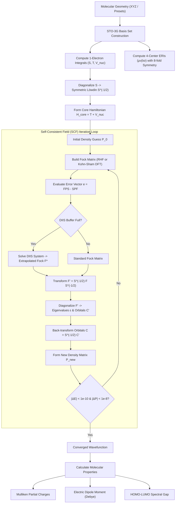

# OrbitalForge

[](https://github.com/ZengLLQ/orbital-forge/actions)
[](https://www.rust-lang.org/)
[](LICENSE)
[]()

**OrbitalForge** is a high-performance ab initio quantum chemistry and molecular electronic structure engine written in pure Rust. It features analytical Gaussian basis integral evaluations via Obara-Saika recurrence relations, Restricted Hartree-Fock (RHF) self-consistent field (SCF) calculations accelerated by Pulay's Direct Inversion in the Iterative Subspace (DIIS), and Kohn-Sham Density Functional Theory (DFT) with Local Density Approximation (LDA) using real-space multicenter numerical quadrature grids.

---

## Key Features

1. **Analytical Gaussian Integrals (Obara-Saika Recurrence):**
   - Full analytical evaluations of 1-electron integrals: Overlap ($S_{\mu\nu}$), Kinetic ($T_{\mu\nu}$), and Nuclear-Electron Attraction ($V_{\mu\nu}$).
   - 4-center 2-electron repulsion integrals $(\mu\nu|\lambda\sigma)$ with 8-fold permutational symmetry:
     $$(\mu\nu|\lambda\sigma) = (\nu\mu|\lambda\sigma) = (\mu\nu|\sigma\lambda) = (\lambda\sigma|\mu\nu)$$
   - Analytical Boys function $F_m(T) = \int_0^1 t^{2m} e^{-T t^2} dt$ evaluated via asymptotic continued fractions and downward recursion.

2. **Pople Contracted Gaussian Basis Sets:**
   - Full STO-3G basis set definitions for light and second-row elements ($H, He, C, N, O, F$).
   - Concentric Cartesian Gaussian expansion with exact diagonal normalization:
     $$\langle \chi_\mu | \chi_\mu \rangle \equiv 1.0 \quad (\pm 10^{-12})$$

3. **Restricted Hartree-Fock (RHF) Roothaan-Hall Solver:**
   - Canonical Roothaan-Hall equations $F C = S C \epsilon$.
   - Symmetric Löwdin orthogonalization $S^{-1/2} = U \Lambda^{-1/2} U^\dagger$.
   - Density matrix construction:
     $$P_{\mu\nu} = 2 \sum_{i=1}^{N_{\text{occ}}} C_{\mu i} C_{\nu i}$$

4. **Convergence Acceleration via DIIS (Pulay 1980):**
   - Direct Inversion in the Iterative Subspace minimizing the commutator error vector:
     $$e_k = F_k P_k S - S P_k F_k$$
   - Solves the constrained Lagrangian linear system to extrapolate optimal Fock matrices $F^* = \sum c_i F_i$.

5. **Kohn-Sham Density Functional Theory (DFT-LDA):**
   - Dirac/Slater analytical exchange: $\epsilon_x(\rho) = -\frac{3}{4} \left(\frac{3}{\pi}\right)^{1/3} \rho^{1/3}$.
   - Chachiyo (2016) correlation functional parameterized without singularities.
   - Multicenter spherical polar quadrature grid with Euler-Maclaurin radial and Gauss-Legendre angular integration.

6. **Molecular Properties & Population Analysis:**
   - Mulliken atomic partial population analysis: $q_A = Z_A - \sum_{\mu \in A} (P S)_{\mu\mu}$.
   - Electric dipole moment vectors and magnitudes in Debye:
     $$\vec{\mu} = \sum_A Z_A \vec{R}_A - \sum_{\mu\nu} P_{\mu\nu} \langle \chi_\mu | \vec{r} | \chi_\nu \rangle$$
   - Orbital spectra, eigenvalues, and frontier HOMO-LUMO energy gaps.

---

## Architectural Workflow



---

## Mathematical Formulations

### 1. Obara-Saika Gaussian Recurrence

The Cartesian Gaussian orbital centered at $\vec{A} = (A_x, A_y, A_z)$ is given by:

$$\phi(\vec{r}; \alpha, \vec{l}, \vec{A}) = (x - A_x)^{l_x} (y - A_y)^{l_y} (z - A_z)^{l_z} e^{-\alpha |\vec{r} - \vec{A}|^2}$$

By the Gaussian Product Rule, the product of two Gaussians is a Gaussian centered at $\vec{P} = \frac{\alpha \vec{A} + \beta \vec{B}}{\gamma}$ where $\gamma = \alpha + \beta$:

$$K_{AB} = \exp\left( -\frac{\alpha \beta}{\gamma} |\vec{A} - \vec{B}|^2 \right)$$

The Obara-Saika three-term recurrence relation generates higher angular momentum integrals from fundamental $s$-shell integrals:

$$\begin{aligned}
S_{i+1, j} &= (P_x - A_x) S_{i, j} + \frac{i}{2\gamma} S_{i-1, j} + \frac{j}{2\gamma} S_{i, j-1} \\
T_{i, j} &= \beta (2 j + 1) S_{i, j} - 2\beta^2 S_{i, j+2} - \frac{1}{2} j(j - 1) S_{i, j-2}
\end{aligned}$$

### 2. Roothaan-Hall Hartree-Fock Matrix

For a closed-shell singlet state with $N_{\text{occ}}$ electron pairs:

$$F_{\mu\nu} = H^{\text{core}}_{\mu\nu} + \sum_{\lambda\sigma} P_{\lambda\sigma} \left[ (\mu\nu|\lambda\sigma) - \frac{1}{2} (\mu\lambda|\nu\sigma) \right]$$

The total electronic energy is:

$$E_{\text{elec}} = \frac{1}{2} \sum_{\mu\nu} P_{\mu\nu} \left( H^{\text{core}}_{\mu\nu} + F_{\mu\nu} \right)$$

And total molecular ground-state energy includes nuclear-nuclear Coulomb repulsion:

$$E_{\text{total}} = E_{\text{elec}} + \sum_{A < B} \frac{Z_A Z_B}{|\vec{R}_A - \vec{R}_B|}$$

---

## Benchmark Results (STO-3G Basis)

| Molecule | Method | Equilibrium Distance / Geometry | Total Energy (Hartree) | Total Energy (eV) | Dipole (Debye) | HOMO-LUMO Gap (eV) |
| :--- | :---: | :---: | :---: | :---: | :---: | :---: |
| $\text{H}_2$ | RHF | $R = 1.40107\ a_0$ | **-1.11671 Hartree** | -30.387 eV | 0.0000 D | 19.467 eV |
| $\text{HeH}^+$ | RHF | $R = 1.46320\ a_0$ | **-2.84414 Hartree** | -77.393 eV | 1.6420 D | 28.530 eV |
| $\text{H}_2\text{O}$ | RHF | $R_{\text{OH}} = 1.809\ a_0, \theta = 104.5^\circ$ | **-91.82057 Hartree** | -2498.565 eV | 1.3941 D | 27.716 eV |
| $\text{H}_2$ | DFT-LDA | $R = 1.40000\ a_0$ | **-0.72364 Hartree** | -19.691 eV | 0.0000 D | 20.395 eV |

---

## CLI Usage

### Build and Run

```bash
# Clone the repository
git clone https://github.com/ZengLLQ/orbital-forge.git
cd orbital-forge

# Run standard RHF benchmark on Water (H2O)
cargo run -- --molecule water

# Run Kohn-Sham DFT calculation on Hydrogen (H2)
cargo run -- --molecule h2 --dft

# Output structured JSON for automation pipelines
cargo run -- --molecule h2 --json
```

### CLI Arguments

```text
Usage: orbital-forge [OPTIONS]

Options:
  -m, --molecule <NAME>       Target molecule preset ('h2', 'water', 'heh+', 'h3+') [default: h2]
  -f, --file <PATH>           Path to custom .xyz molecular structure file
      --dft                   Enable Kohn-Sham DFT with Local Density Approximation (LDA)
      --max-iter <N>          Maximum SCF iterations [default: 60]
      --energy-tol <TOL>      Energy convergence threshold [default: 1e-9]
      --no-diis               Disable DIIS acceleration
      --json                  Output full results in JSON format
  -h, --help                  Print help information
```

---

## Verification & Testing

OrbitalForge features comprehensive automated tests covering mathematical primitives, basis set normalization, analytical integral symmetries, DIIS convergence speedup, and RHF/DFT benchmark energies:

```bash
cargo test
```

Test breakdown:
- `test_math`: Analytical Boys function properties, double factorials, and error function clamping.
- `test_basis`: Pople STO-3G basis construction, normalization invariants $\langle \chi_\mu | \chi_\mu \rangle = 1.0$.
- `test_integrals`: Hermitian matrix symmetries and 8-fold permutational symmetry of 4-center ERIs.
- `test_scf_rhf`: Ground state energies for $\text{H}_2$, $\text{HeH}^+$, and $\text{H}_2\text{O}$ against theoretical quantum chemistry values.
- `test_dft_lda`: Analytical Dirac exchange, Chachiyo correlation limits, and Kohn-Sham convergence.
- `test_diis`: Verification that DIIS accelerates convergence compared to simple Fock dampening.

---

## License

This project is licensed under the [MIT License](LICENSE).
